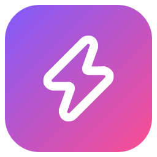
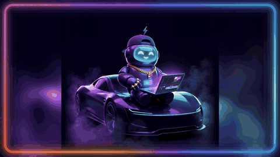
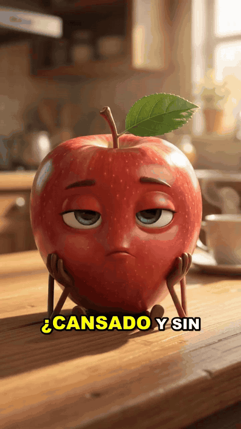
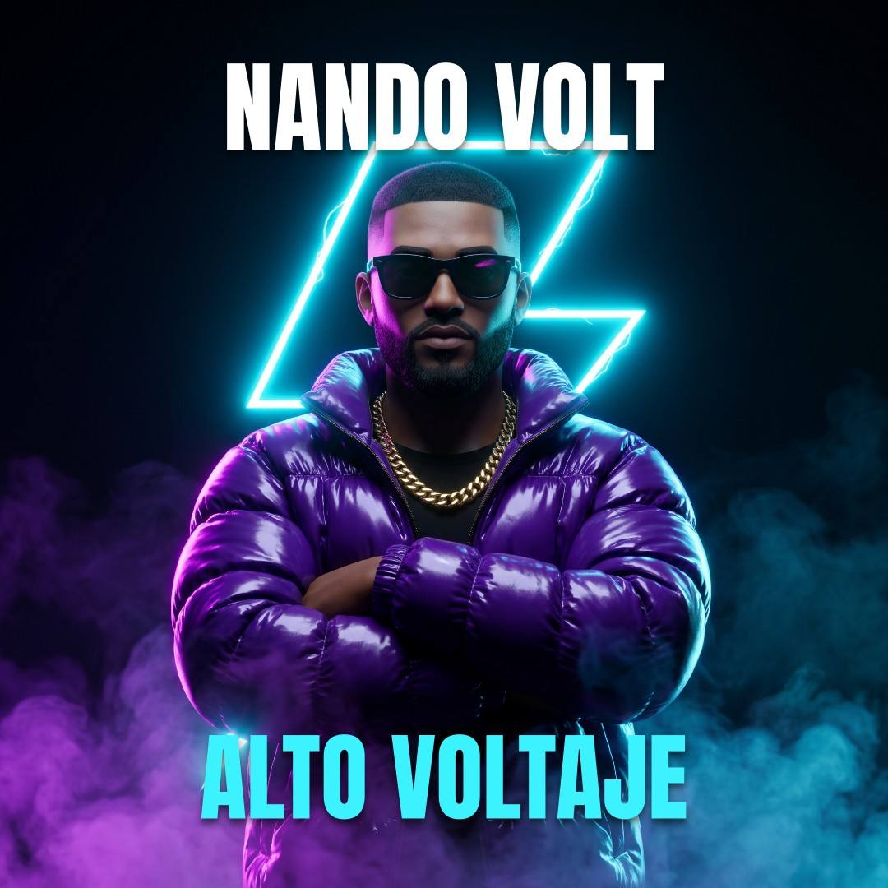
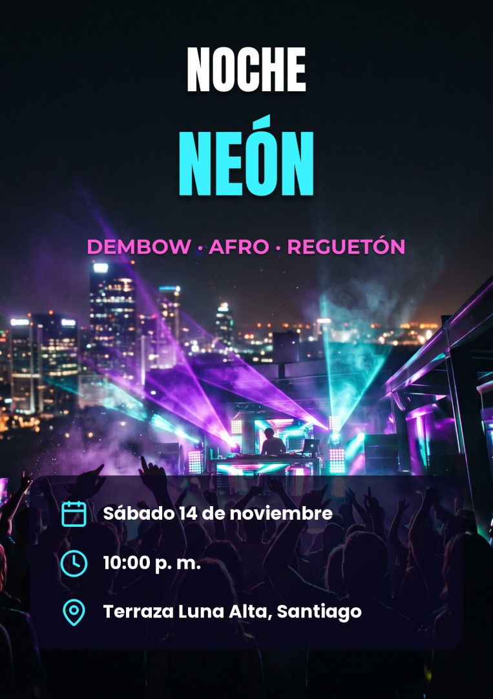
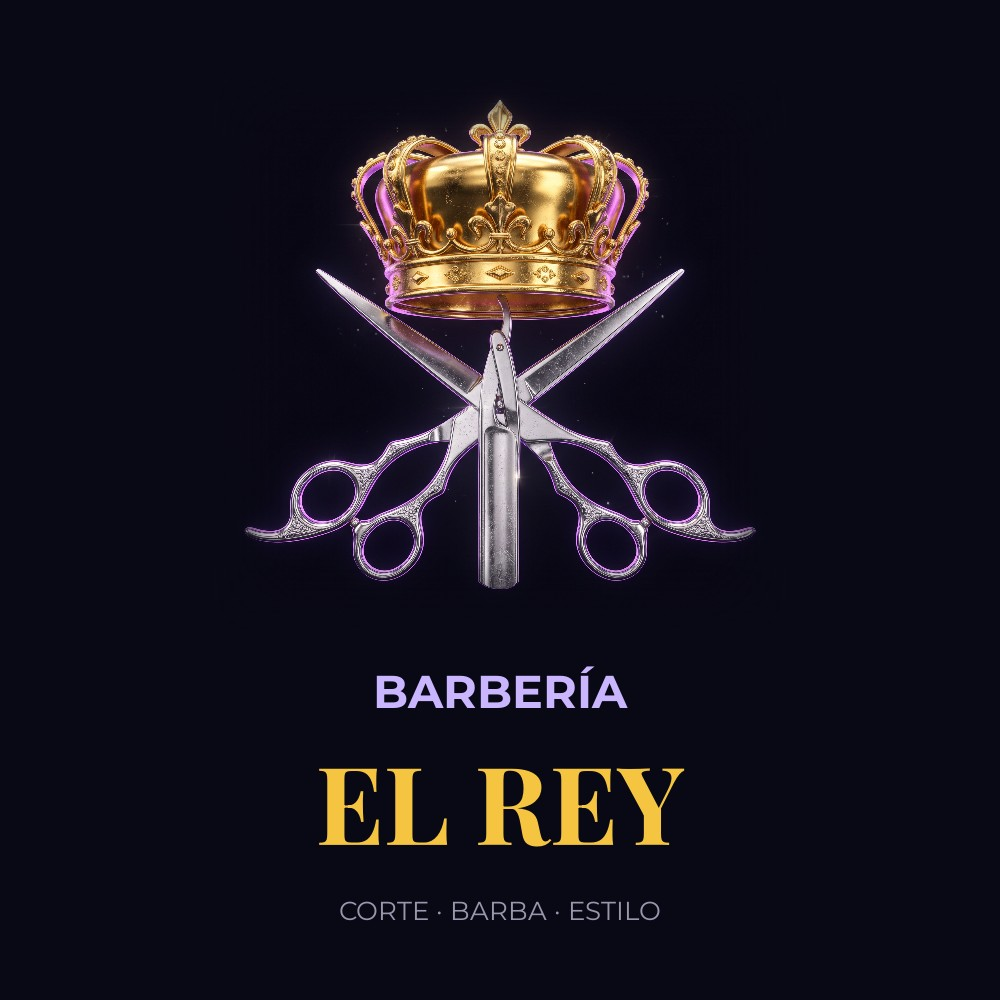
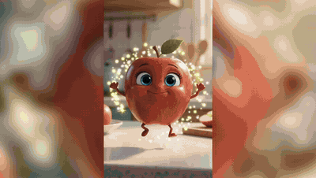
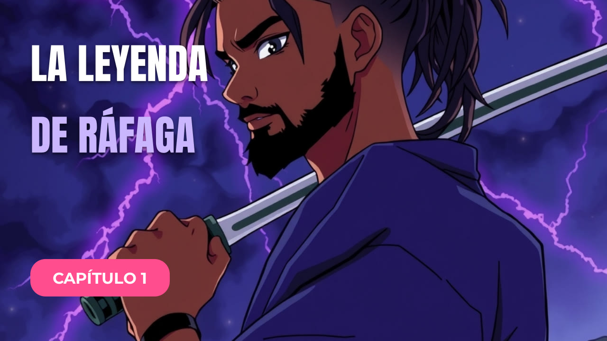
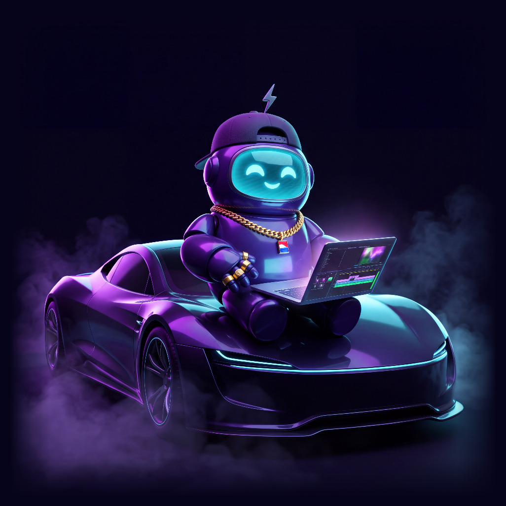

<div align="center">



# Ráfaga Studio

Ráfaga Studio existe para ayudar a los creadores de contenido a hacer sus videos fácilmente, sin tanta edición y sin pagar muchas herramientas a la vez.

El estudio creativo con IA para Windows. Describe tu idea, conecta tu propia clave y recibe un video terminado.<br>
O conecta tu IA favorita por MCP y dirige todo el estudio desde tu chat.

[](https://github.com/santo29/rafaga-studio/releases/latest)
[](LICENSE)
[](#instalación)
[](#conecta-tu-ia-favorita-mcp)
[](idiomas)

[Descargar para Windows](https://github.com/santo29/rafaga-studio/releases/latest) ·
[Configuración gratis](#configuración-gratis-3-videos-al-día) ·
[Ver la demostración](ejemplos/presentacion-app.mp4) ·
[Read in English](README.md)

<a href="ejemplos/presentacion-app.mp4"></a>

<sub>Este video se hizo con el propio Ráfaga Studio: la app real en pantalla y su propio editor.</sub>

</div>

## Resumen

Ráfaga Studio convierte una frase en contenido terminado: guion, escenas, voz, subtítulos y montaje final. Funciona en
tu PC, sin programar, sin consola, sin cuentas y sin suscripciones.

- **Tu IA favorita dirige el estudio.** Conéctala por MCP, pide desde tu chat y gasta menos en tu API.
- **Un solo cuadro para todas las claves.** Pegas una clave y la app reconoce de qué servicio es.
- **Movimiento real.** Texto a video y foto a video, en tu propia nube Modal o en el servicio de video con IA que elijas.
- **Un Director con IA.** Pides por texto o por voz, adjuntas tus fotos, y planifica el trabajo y usa las herramientas
  adecuadas.
- **Sin costos sorpresa.** Siempre hay opciones gratis, y lo de pago enseña su costo máximo y pregunta antes.
- **Tus datos son tuyos.** Sin servidores nuestros y sin analítica. Las claves se guardan cifradas en tu PC.

## Funciones

| Herramienta | Qué hace |
|---|---|
| Director IA | Planifica y ejecuta trabajos completos desde un pedido por texto o voz, en un chat a página completa que muestra tus adjuntos y resultados |
| Crear con IA | De la idea al video terminado, vertical u horizontal, con movimiento de IA, voz, subtítulos y acabado de estudio |
| Foto a video | Da vida a una foto con el movimiento de cámara que elijas |
| Editor de video | Línea de tiempo, transiciones, efectos al ritmo, textos, stickers, subtítulos automáticos, exportación 4K, grabación con cámara y avatar con IA (beta) |
| Diseño | Publicaciones, miniaturas, flyers, logos y estampados por capas, con composición de la IA y exportación 4K |
| Shorts mágicos | Encuentra los mejores momentos de un video largo y los recorta en vertical con subtítulos |
| Anuncios | Convierte la foto de un producto en varias versiones de anuncio para pruebas A/B |
| Música | Letras, producción y videos musicales con karaoke en cualquier género |
| Cabina de grabación | Graba sobre una pista, con afinación, cadenas de voz, mezcla y máster |
| Dibujos animados | Series animadas con personajes coherentes, guion gráfico y voces |
| Nichos virales | Investiga datos reales de YouTube y propone nichos con ideas listas |
| Publicar | Programa videos en YouTube con tu propia app de Google |

## Conecta tu IA favorita (MCP)

Convierte la IA que ya usas en un estudio creativo completo. Conéctala una vez y pide lo que quieras desde tu chat:

> Haz un video vertical de 30 segundos sobre tres lugares de la República Dominicana.

Tu IA dirige. Ráfaga Studio produce las imágenes, el movimiento, la voz, los subtítulos y el montaje final, y entrega el
archivo terminado.

- **Gasta menos en tu API.** Tu IA puede escribir los guiones y los diseños, así el estudio no hace llamadas propias a
  una IA de texto para ese trabajo. Las imágenes y el video usan los servicios elegidos en **Claves de IA**, donde siempre
  hay opciones gratis.
- **Crea mucho más que video.** Sus 17 herramientas cubren shorts, anuncios, canciones, videos musicales, diseño, edición,
  series animadas, investigación de nichos y programación en YouTube.
- **Mantén el control.** Lo que gasta dinero, publica o guarda en la memoria espera tu aprobación en una ventana de Ráfaga
  Studio.

Para conectarla, abre **Conexión MCP** en la app y elige conectar. Ráfaga Studio se registra en Claude Code y Claude
Desktop. Otros clientes [MCP](https://modelcontextprotocol.io) pueden iniciar `mcp_server.py` con el Python de la app.

## Instalación

Requisitos: Windows 10 u 11 de 64 bits, unos 3 GB libres y conexión a internet. No hace falta tarjeta gráfica.

1. Baja `RafagaStudio-Setup-1.0.0.exe` (unos 52 MB) desde
   [Versiones](https://github.com/santo29/rafaga-studio/releases/latest), en la sección Assets.
2. Ábrelo. El instalador aún no tiene firma digital, así que Windows puede mostrar «Windows protegió su PC». Elige
   **Más información** y luego **Ejecutar de todas formas**. No pide permisos de administrador.
3. Acepta los términos y elige **Instalar**. El instalador descarga Python y las librerías de IA (unos 1,5 GB, de 10 a
   30 minutos) y comprueba la huella de cada archivo. Si se corta la conexión, ejecútalo otra vez y sigue donde quedó.

## Primeros pasos

1. Abre **Crear con IA** y escribe tu idea, por ejemplo: *5 datos impactantes del fondo del océano, tono misterioso*.
2. Elige **Generar video**. Una barra de progreso muestra cada escena mientras se hace.
3. Al terminar, míralo en el reproductor, abre su carpeta o envíalo al editor de video.

Funciona sin ninguna clave, con servicios gratis que pueden ser más lentos y dar resultados más simples. Conectar Groq y
Cloudflare toma unos dos minutos, no cuesta nada y da un primer video mucho mejor. Mira la
[configuración gratis](#configuración-gratis-3-videos-al-día).

## Configuración gratis: 3 videos al día

No necesitas un plan de pago para empezar. Crea estas claves gratis, pega cada una en **Claves de IA** y podrás hacer unos
tres videos cortos al día sin costo.

| Servicio | Qué hace | Lo que da gratis | Dónde conseguirla |
|---|---|---|---|
| Groq | Escribe los guiones | Plan gratis | [Crear clave](https://console.groq.com/keys) |
| Cloudflare Workers AI | Dibuja las imágenes | Unas 100 imágenes al día | [Crear token](https://dash.cloudflare.com/profile/api-tokens) |
| Modal (opcional) | Añade movimiento real con Wan 2.2 | US$30 de cómputo al mes | [Crear token](https://modal.com/settings/tokens) |

Las voces (Microsoft Edge) y los subtítulos (Whisper, en tu PC) ya vienen incluidos y no necesitan clave.

Lo que cabe en estas cuotas:

- **Tres videos de 45 segundos al día** usan hasta 30 imágenes, muy por debajo de la cuota diaria de Cloudflare.
- **El crédito de Modal** alcanza para unas 85 escenas con movimiento al mes: cerca de 3 al día, o unos 8 videos de 45
  segundos animados por completo. Las demás escenas llevan un zoom suave.
- **Sin Modal**, un Space público y gratis de Hugging Face anima unas pocas escenas al día, con fila de espera. No necesita
  clave.

El crédito de US$30 de Modal pide una tarjeta registrada, así que [pon un límite de uso de US$30](https://modal.com/settings/usage)
y no pagas nada. Cada servicio fija sus límites, y pueden cambiar. Las voces gratis de Edge no están garantizadas para uso
comercial. Los modelos gratis también pueden cometer errores: mira
[modelos gratis y económicos](#modelos-gratis-y-económicos).

## Modelos gratis y económicos

Los modelos gratis son una buena forma de empezar, pero pueden cometer errores o alejarse de lo que pediste: una escena
puede perder un detalle, mostrar algo que no pediste o no coincidir con la narración. Esto puede pasar aunque Claude u otra
IA dirija el estudio por MCP. Tu IA escribe el guion y los pedidos, pero las imágenes y el video los hacen los servicios
que conectaste.

Para los videos que vayas a publicar, recomendamos un modelo económico para las imágenes, como Nano Banana en Gemini.

Este es el mismo pedido enviado a dos modelos durante una prueba real de Ráfaga Studio:

| Pedido | Gratis: FLUX.1 schnell en Cloudflare | Económico: Nano Banana en Gemini, unos US$0,03 por imagen |
|---|---|---|
| Semillas espinosas de bardana sobre lana y pelo de perro |  |  |
| Un zapato deportivo blanco con correa de tela y sin cordones |  |  |

Los resultados cambian según el modelo y el pedido, y ningún modelo acierta siempre. Para obtener mejores resultados:

- Describe cada escena con detalle, también lo que no debe aparecer.
- Elige tus servicios de imágenes y video en **Claves de IA**.
- Revisa cada escena antes de publicar.

## Conecta tus servicios de IA

Abre **Claves de IA**, elige **Conseguir clave** junto a un servicio, créala en su sitio web y pégala en el cuadro de
arriba. Las claves se cifran con tu cuenta de Windows, y cada una solo viaja a su propio servicio.

| Servicio | Qué añade | Precio |
|---|---|---|
| Groq | Guiones y transcripción rápidos | Gratis |
| Cloudflare Workers AI | Unas 100 imágenes al día. Pega juntos el ID de cuenta y el token | Gratis |
| Pollinations | Imágenes y guiones | Gratis |
| Gemini | Guiones y, si los eliges, imágenes Nano Banana, video con voz y música Lyria | Gratis, con opciones de pago |
| Modal | Tu propia nube de video con IA (Wan 2.2). Pega las dos partes del token y elige **Instalar motor en Modal** | US$1 gratis al mes, o US$30 con una tarjeta registrada (pon en Modal un límite de US$30 y no pagas nada) |
| ElevenLabs | Voces realistas y música | Plan gratis pequeño |
| Kling, Seedance | Escenas animadas y con voz | De pago, solo si los eliges |

El movimiento real se controla con **Animar escenas con IA de video**, en **Claves de IA**: déjalo en Automático o elige
tu nube Modal. **Comprobar conexiones** muestra el estado real de cada servicio y qué hacer si algo falla.

<details>
<summary>Todos los proveedores</summary>

| Tarea | Gratis | Con créditos o de pago |
|---|---|---|
| Texto y guiones | Groq, Gemini, Pollinations (sin clave) | Claude, OpenAI, OpenRouter, xAI, DeepSeek |
| Imágenes | Cloudflare Workers AI, Pollinations, FLUX en Hugging Face (sin clave) | OpenAI, Replicate, Gemini Nano Banana |
| Imagen a video | Hugging Face ZeroGPU (Wan 2.2) | Tu nube Modal, Pollinations, Gemini Omni, Kling, Seedance |
| Video con voz y labios sincronizados | | Gemini Omni, Kling, Seedance |
| Voz | Voces de Microsoft Edge | ElevenLabs |
| Transcripción | Tu PC (Whisper), Groq | OpenAI |
| Separar voz y pista | Tu PC (Demucs) | |
| Música | | ElevenLabs Music, Gemini Lyria |

En modo Automático la app usa primero tu nube Modal si está conectada, y después las opciones gratis. Kling y Seedance
nunca se usan en Automático, y los clips de pago tienen un tope de 15 por trabajo.

</details>

## Ejemplos

Todo lo siguiente se hizo con Ráfaga Studio. Las marcas y las personas son ficticias.

| Personaje que habla | Tráiler de anime | Movimiento con IA |
|---|---|---|
| <a href="ejemplos/manzana-habla.mp4"></a> | <a href="ejemplos/leyenda-rafaga.mp4"></a> | <a href="ejemplos/baile-merengue.mp4"></a> |

| Portada de álbum | Flyer de evento | Logo |
|---|---|---|
|  |  |  |

| Anuncio de marca | Miniatura de YouTube | Mascota |
|---|---|---|
| <a href="ejemplos/anuncio-rafaga.mp4"></a> |  |  |

Los pedidos y los diseños por capas de estos ejemplos están en [`ejemplos/`](ejemplos), y se pueden reproducir con
`python ejemplos/crear.py` y `python ejemplos/crear_disenos.py`.

## Privacidad y seguridad

Ráfaga Studio no tiene servidores nuestros, cuentas ni analítica. Las funciones de IA envían tus pedidos directamente al
servicio que hace el trabajo, también a los servicios gratis sin clave. Cada envío de datos está en el
[aviso de privacidad](PRIVACIDAD.md).

Ráfaga Guardia, integrado en la app, registra lo que la app bloquea, comprueba que su código es el que instalaste y puede
bloquear lo sensible hasta que lo desbloquees. Lee [SECURITY.md](SECURITY.md) para ver los detalles y límites, y para
informar de una vulnerabilidad.

## Preguntas frecuentes

<details>
<summary>¿Es gratis?</summary>

Sí. La app no tiene cuentas, suscripciones ni pagos internos. Solo pagas los servicios de IA que elijas usar, directamente
a ellos, y la app enseña antes el costo máximo. Se permite el uso comercial de lo que crees; consulta los
[términos](TERMINOS.md). Las voces gratis de Microsoft Edge no están garantizadas para uso comercial: para eso, usa una
voz con licencia comercial.

</details>

<details>
<summary>¿Necesito un PC potente?</summary>

No. Las imágenes y la animación las hacen servicios en internet o tu nube Modal. Tu PC monta el video y hace la
transcripción y la separación de voz y pista con el procesador.

</details>

<details>
<summary>¿Qué pasa si un servicio falla o se queda sin saldo?</summary>

La app avisa y pasa a la siguiente opción disponible, sin pagar dos veces. Si un paso solo se puede hacer pagando, se
detiene antes de cobrar y te dice cómo arreglarlo. **Actividad de la IA**, en **Claves de IA**, enseña cada llamada y un
estimado de lo gastado.

</details>

<details>
<summary>¿Dónde están mis videos?</summary>

En **Mis proyectos**. Elige un proyecto y luego **Abrir carpeta**. Desinstalar la app no borra tus proyectos ni tus
claves.

</details>

<details>
<summary>¿Funciona en macOS o Linux?</summary>

Todavía no. Está en el plan de trabajo.

</details>

## Desarrollo

Requiere Python 3.14. Se recomienda [Node.js](https://nodejs.org) para las descargas de YouTube.

```bat
git clone https://github.com/santo29/rafaga-studio.git
cd rafaga-studio
"Ráfaga Studio.bat"
```

Usa el motor como librería de Python:

```python
from motor import desde_prompt, shorts

desde_prompt.generar("Una manzana que habla explica por qué la fruta da energía", formato="9:16", segundos=16)
shorts.generar("https://youtu.be/…", formato="9:16", cantidad=3)
```

- Un solo registro de herramientas alimenta al Director y al servidor MCP, para que nunca se separen.
- Lo que llega de fuera se comprueba en cada frontera: el contenido de los archivos, los enlaces, las claves y los guiones
  que escriben los agentes.
- Las dependencias van fijadas con su huella en `requirements.lock`.
- `python -m pruebas` ejecuta todo el estudio sin internet, con servicios de IA falsos y sin claves.
- `ISCC instalador\rafaga.iss` crea el instalador con [Inno Setup](https://jrsoftware.org/isinfo.php) 7.

## Plan de trabajo

- [x] De la idea al video, shorts, anuncios, música, diseño, editor de video y dibujos animados
- [x] Director IA con voz en tu PC y servidor MCP
- [x] Personajes que hablan con labios sincronizados
- [x] Instalador para Windows
- [ ] Avatares con IA estables en tu propia nube con GPU
- [ ] Versiones para macOS y Linux
- [ ] Sistema de complementos para nuevos proveedores y efectos

## Contribuir

Las ideas, los informes de errores y los pull requests son bienvenidos. Lee [CONTRIBUTING.md](CONTRIBUTING.md) para
empezar. Buenas primeras contribuciones: nuevos proveedores gratis en `motor/nubes.py`, estilos de voz en
`motor/cabina.py`, géneros en `motor/musica.py` y traducciones en `idiomas/`.

Si Ráfaga Studio te resulta útil, dale una estrella al repositorio. Así lo encuentran más creadores.

## Uso responsable

Usa contenido propio o con permiso, no imites a personas reales sin su consentimiento, y marca el contenido realista
hecho con IA, como exigen YouTube, TikTok y Meta. Consulta los [términos](TERMINOS.md).

## Agradecimientos

Hecho con FFmpeg, faster-whisper, yt-dlp, Pedalboard, Demucs, Matchering, librosa, Praat, Wan 2.2, FLUX, edge-tts, Lucide
y Google Fonts. Lista completa en los [avisos de terceros](AVISOS_DE_TERCEROS.md).

Creado en la República Dominicana por Santo Montilla, con fe en Dios y con Claude como compañero de desarrollo.

## Licencia

Ráfaga Studio es software libre con la [Licencia Pública General de GNU v3.0](LICENSE). Puedes usarlo, estudiarlo,
cambiarlo y repartirlo, también con fines comerciales, siempre que quien reciba tu versión reciba también su código con
la misma licencia. Se ofrece sin garantía.

Los iconos (Lucide, ISC) y las fuentes (Google Fonts, OFL) conservan sus propias licencias. El nombre, el logo, la
portada y la mascota de Ráfaga Studio™ son marcas de Santo Montilla y no entran en la GPL: si repartes una versión
modificada, ponle otro nombre y otro logo.

© 2026 Santo Montilla
