<div align="center">


# Ráfaga Studio

**The AI creative studio for Windows, made for people who don't code.**<br>
Install it, paste a key, and the app recognizes which service it belongs to.<br>
Ask for a video in one sentence and get the script, the scenes, the voice, the subtitles and the final cut.

[](https://github.com/santo29/rafaga-studio/releases/latest)

[](#-no-coding-your-first-video-in-5-minutes)
[](LICENSE)
[](#-no-coding-your-first-video-in-5-minutes)
[](#-drive-it-from-claude-mcp)
[](idiomas)

[**▶ Watch the demo**](ejemplos/presentacion-app-en.mp4) ·
[**▶ Watch the ad**](ejemplos/anuncio-rafaga-en.mp4) ·
[**🇪🇸 Leer en español**](README.es.md)

<a href="ejemplos/presentacion-app-en.mp4">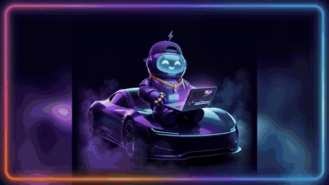</a>

<sub>This demo (<a href="ejemplos/presentacion-app.mp4">Spanish version</a>) was edited by Ráfaga Studio's own video
editor. Claude wrote the script as the studio's Director.</sub>

<a href="ejemplos/anuncio-rafaga-en.mp4"></a>

<sub>The brand ad (<a href="ejemplos/anuncio-rafaga.mp4">Spanish version</a>), in 4K, also made with the studio: the
people and their voices are fictional, made with AI, with the real app on their screens, and the music is a song
made with Ráfaga Studio.</sub>

</div>

---

Ráfaga Studio is a **desktop AI video generator** for Windows: text to video, shorts for TikTok, Reels and YouTube,
product ads, songs, 4K designs and cartoons, with an **AI Director you can talk to**. There is no code to write and no
terminal to open: everything is done with buttons, in English, **Spanish**, Portuguese or French. Free providers come
first, and paid ones are only used when you choose them.

## 🚀 No coding: your first video in 5 minutes

The 5 minutes are your part, counted from when the app is installed. Installing downloads about 1.5 GB and takes 10
to 30 minutes depending on your internet, and in free mode the video can take longer to come out, because free
services work through a queue.

**You need:** 64-bit Windows 10 or 11, about 3 GB of free space and internet. No graphics card needed.

### 1. Download and install

1. Download `RafagaStudio-Setup-1.0.0.exe` (about 52 MB) from
   [Releases](https://github.com/santo29/rafaga-studio/releases/latest) and open it. Under "Assets", click
   `RafagaStudio-Setup-1.0.0.exe` (not "Source code"). If your browser says the file isn't commonly downloaded, click
   "…" and "Keep".
2. **Windows shows a blue warning window: "Windows protected your PC".** It appears because the installer is not
   digitally signed yet. Click **"More info"** and then **"Run anyway"**. This warning comes from Windows, not from
   the app. It won't ask for admin rights: it installs only for your account.
3. Pick the language, read the terms (they are in Spanish), choose **"I accept the terms"** and continue. There is no
   folder to choose. Leave **"Create a desktop shortcut"** checked, click **Next** and then **Install**.
4. The installer downloads Python (the program the app runs on) and the AI libraries by itself, verifying the hash
   of every file. The bar moves on its own and shows what it is downloading. If your internet drops, click
   **"Try again"**, or run the installer again later: it continues where it stopped.
5. When it finishes, leave **"Open Ráfaga Studio"** checked and click **Finish**.

### 2. Open it

The first time, **"Welcome to Ráfaga Studio"** shows what matters for your privacy in four points: no servers and no
accounts, your keys stay encrypted on your PC, which free services receive your requests, and use your own content.
Click **"✨ I accept, let's start"**.

The app opens in your PC's language. To change it, use the selector at the bottom of the side menu.

### 3. Make your first video, with no key at all

1. Click **"✨ Create with AI"** in the menu, or the **"Create video"** card on Home.
2. Type your idea, for example: *5 shocking facts about the deep ocean, mysterious tone*.
3. Leave the rest as it is: vertical 9:16, style "Automatic", the free voice and 45 seconds.
4. Click **"✨ Generate video"**. Nothing paid is used, so it won't ask you to approve any cost. A progress bar
   shows what it is doing, scene by scene.
5. If a free service fails, you still get the video: with the previous image, or with a gentle zoom instead of
   motion. At the end it tells you what happened. With no keys the video is simpler: few new images (other scenes
   reuse the previous one with a gentle zoom). For a much better first video, connect Groq and Cloudflare first
   (free, about 2 minutes): see [“Your first key”](#-your-first-key-copy-and-paste).
6. The video shows up in the player. **"Open folder"** takes you to the file, **"Copy text to post"** gives you the
   text for your social post and **"✂️ Edit"** sends it to the editor.

Without keys, the studio thinks with a slower free AI; the Director tells you so in its chat when the app opens and
suggests connecting Groq or Gemini (free) in "AI keys". That's the next step.

## 🔑 Your first key: copy and paste

An API key is a password each AI service gives you so the app can work with your account. Getting one and adding it
takes no programming:

1. Open **"🔑 AI keys"** in the menu.
2. In **"Services you can connect"**, click **"Get key ↗"** next to the service you want: it opens the page where the
   key is created. Create it and copy it.
3. Paste it in the box at the top and click **"Connect"** (or press Enter). One box for all of them: the app
   **recognizes which service the key is for**, checks it and adds it to the list. What you paste is hidden; "Show
   key" reveals it so you can check it was pasted whole.

Keys are stored encrypted and only on your PC. You can connect several, and each one is used for its own job.

**The first ones worth connecting:**

| Service | What it unlocks | Price |
|---|---|---|
| Groq | Fast AI scripts (without a key they are slow) and fast transcription | Free |
| Cloudflare Workers AI | About 100 images a day. Paste the account ID and the token together | Free |
| Pollinations | Images and scripts with no watermark | Free |
| Gemini (Google) | Free scripts. If you choose them: Nano Banana images, talking animated videos and Lyria music | Free (the rest is paid) |
| Modal | Your own AI video cloud (Wan 2.2): scenes really move. Paste both parts of the token (`ak-…` and `as-…`) and click "Install engine on Modal" | US$1 free a month, or US$30 free a month if you add a card (set a US$30 usage limit on Modal and you pay nothing) |
| ElevenLabs | Realistic voices and music | Small free plan |

Almost everything works with no key. AI music (ElevenLabs or Gemini) and talking characters with lip sync (Gemini,
Kling or Seedance, paid) need one. Publishing to YouTube needs a one-time Google app setup; the app guides you.

**Does each key work?** Click **"Check connections"**: each service shows its status ("Working", "Key is valid", "No
balance", "Missing a permission", "Invalid key", "Out of quota for now"…) and, if something is wrong, what to do in
one sentence, such as where to top up. Some services (Claude, OpenAI, Modal…) only reveal their balance when used:
the check says "Key is valid", and a missing balance shows up on the first job and in "AI activity".

## ❓ FAQ

**Is it free?**
The app charges you nothing: no accounts, no subscription, no in-app payments. You can use it for your content,
commercial use included (see the [Terms](TERMINOS.md), in Spanish). With no key at all it already does scripts,
images, animation (with the free quota of a public Hugging Face Space, a few minutes a day), voices, subtitles and
editing. Paid services (Gemini, ElevenLabs, Kling, Seedance…) are only used if you choose them, and the app shows the
maximum cost first. Note: the free Microsoft Edge voices are not guaranteed for commercial use; for that, use a voice
with a commercial license.

**Do I need a powerful PC?**
No graphics card needed. Images and animation are made by internet services or on your Modal cloud. Your PC puts the
video together and runs transcription (Whisper) and vocal/beat separation (Demucs) on the processor. It needs 64-bit
Windows 10 or 11, about 3 GB of free space and internet.

**Is my key safe?**
It is encrypted with your Windows account (DPAPI) and stored only on your PC: only your user can read it. Each key
only travels to its own service and never goes in a web address; the key list only shows the start and the end of
each one. Your Hugging Face token is never sent to third-party Spaces. Uninstalling does not delete your projects or
your keys.

**What if a service runs out of balance?**
"Check connections" marks it "No balance" and tells you where to top up (with Claude, OpenAI, Modal and a few others,
only once they are used). Before a job the app warns you and moves on to another option: if your text AI has no
balance, it uses another connected one or the free no-key AI; images go to the next option, and if animation can't
run, the scene gets a gentle zoom. If it already knows the balance is gone, a step that can only be done by paying (a
talking video, a song) doesn't even start: it tells you how to fix it and nothing is charged. In **"AI keys"**,
further down, the **"AI activity"** section lists every AI call and a high estimate of what was spent today and this
month.

**The app says my key is invalid, but I know it's good.**
Read the details of the message. If it mentions a permission ("missing the permission…"), the key lacks a permission:
ElevenLabs, for example, lets you create keys with individual permissions. On the service's website, edit the key,
give it full access and connect it again or click "Check connections". If the message is about the connection, check
your internet and try again.

**Where are my videos?**
In **"🎬 My projects"**: pick one and click **"Open folder"**. They are in
`C:\Users\<your user>\AppData\Local\Programs\Ráfaga Studio\datos\proyectos`.

**Does it run on Mac or Linux?**
Not yet: for now it is Windows 10 and 11 only.

## 🎬 Made with Ráfaga Studio

| Talking character (9:16) | Anime trailer (16:9) | Real AI motion (Wan 2.2) |
|---|---|---|
|  |  |  |
| [watch](ejemplos/manzana-habla.mp4) · lip-synced voice (Gemini Omni) | [watch](ejemplos/leyenda-rafaga.mp4) · original characters | [watch](ejemplos/leyenda-ia.mp4) · wind, hair and camera really move, on your Modal cloud |

| Mascot in 4K (1:1) | YouTube thumbnail (16:9) |
|---|---|
| 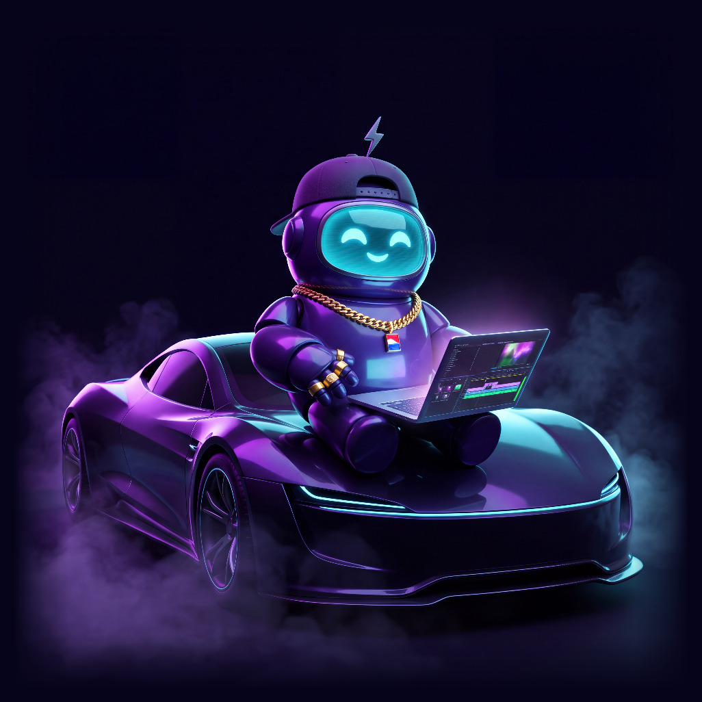 |  |

| Album cover (1:1) | Event flyer (A4) | Logo |
|---|---|---|
| 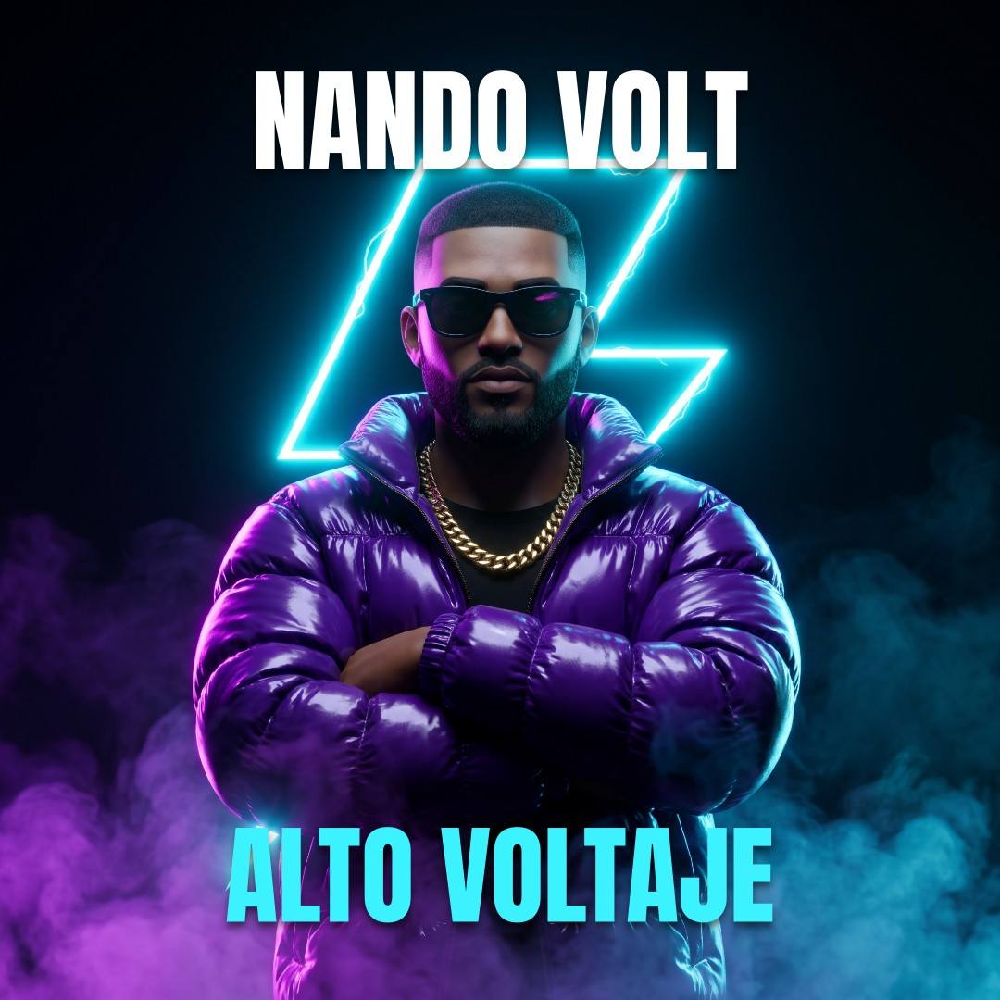 | 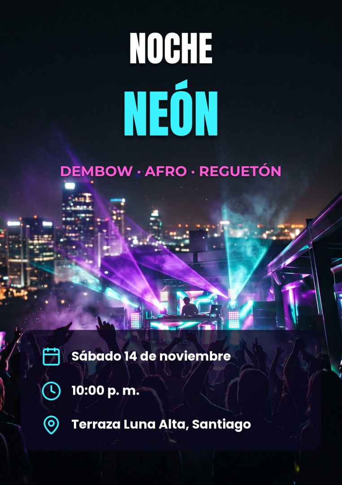 | 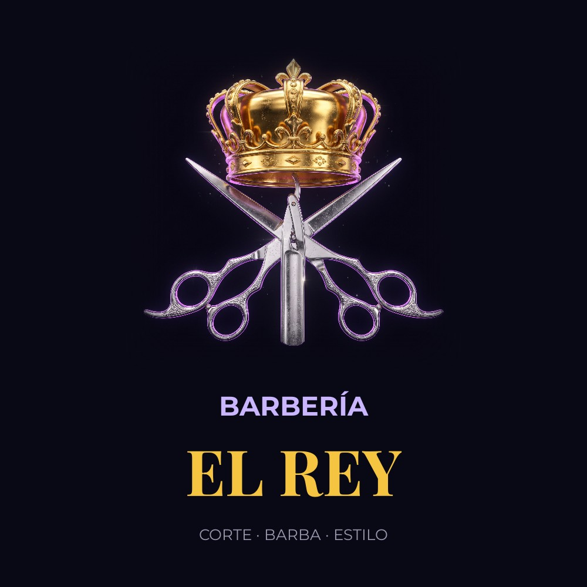 |
| “Alto Voltaje” by a fictional dembow artist · neon dark | Party flyer with date, time and venue · neon dark | Crown emblem for “Barbería El Rey” · 3D render |

| YouTube thumbnail (16:9) | T-shirt print | Brand ad (4:5) |
|---|---|---|
| 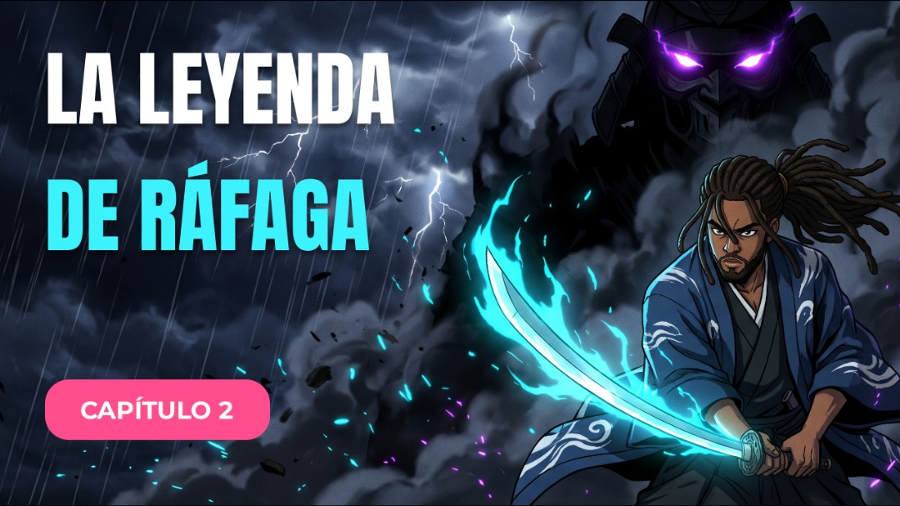 | 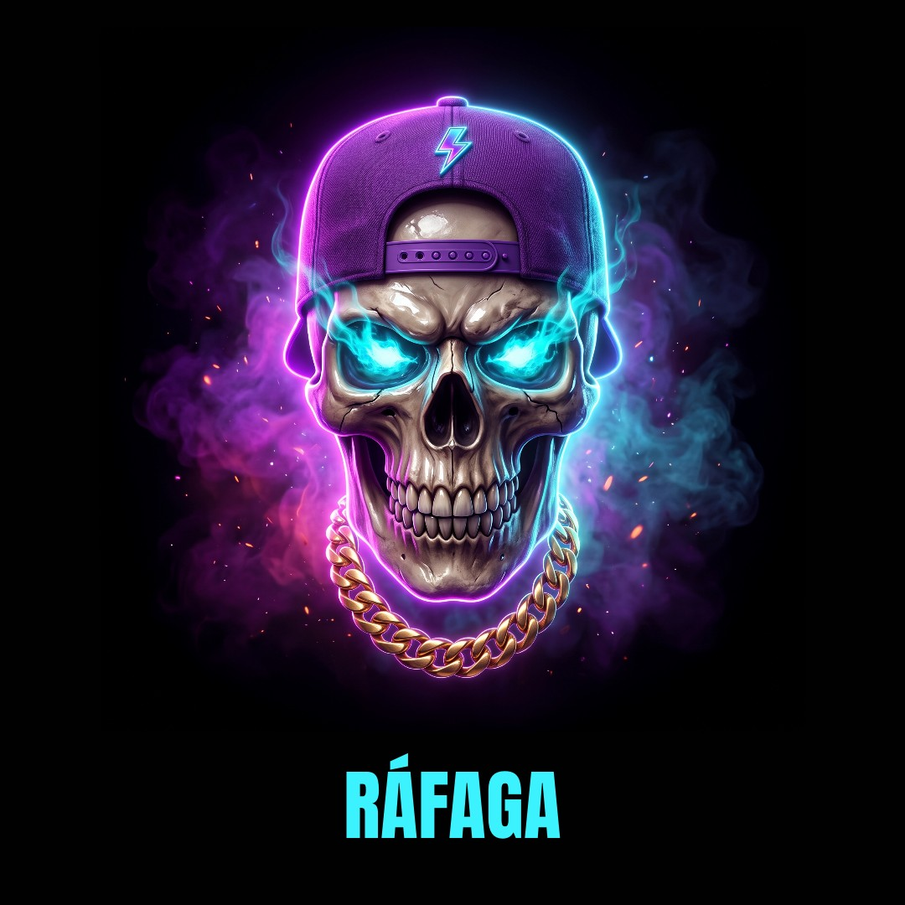 | 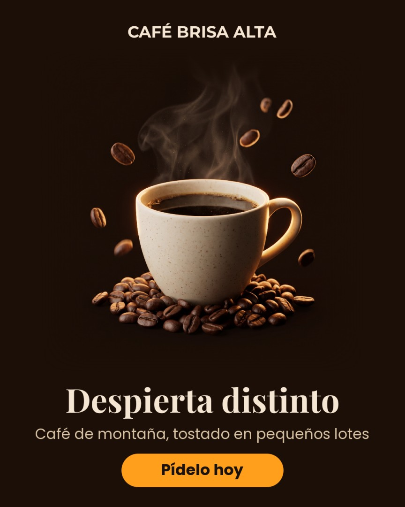 |
| “La leyenda de Ráfaga”, chapter 2 · anime with a neon glow | Neon skull for a black tee · neon dark | “Café Brisa Alta”, the product up front · 3D render |

The six designs above were laid out by Claude as Director in editable layers; the art was drawn by Gemini (Nano Banana
at 2K, about US$0.05 per image) and the studio fitted the text and put each piece together. Every example is
reproducible: the requests, scripts and layered designs are in [`ejemplos/ejemplos.json`](ejemplos/ejemplos.json) and
[`ejemplos/disenos.json`](ejemplos/disenos.json); `python ejemplos/crear.py` rebuilds the videos and
`python ejemplos/crear_disenos.py` the designs. The talking apple uses Gemini (paid, ~US$1 per scene) and the
AI-motion anime uses your own Modal cloud. Brands and people are fictional.

**Straight from a real test of every tool:**

| AI motion, “Just animate the image” (9:16) | Cartoon episode (9:16) |
|---|---|
|  | 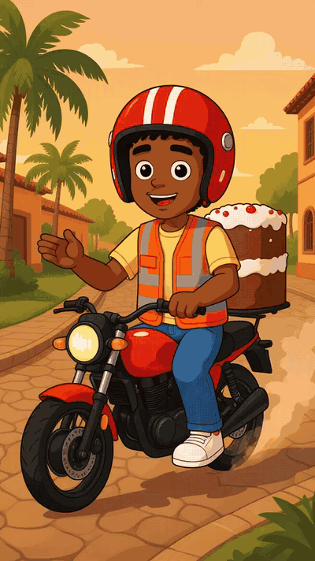 |
| [watch](ejemplos/baile-merengue.mp4) · she spins and her skirt flies | [watch](ejemplos/rafa-y-la-ciudad.mp4) · still drawings with a slow zoom, each character in their own voice |

| Instagram post (1:1) | Cartoon cast |
|---|---|
| 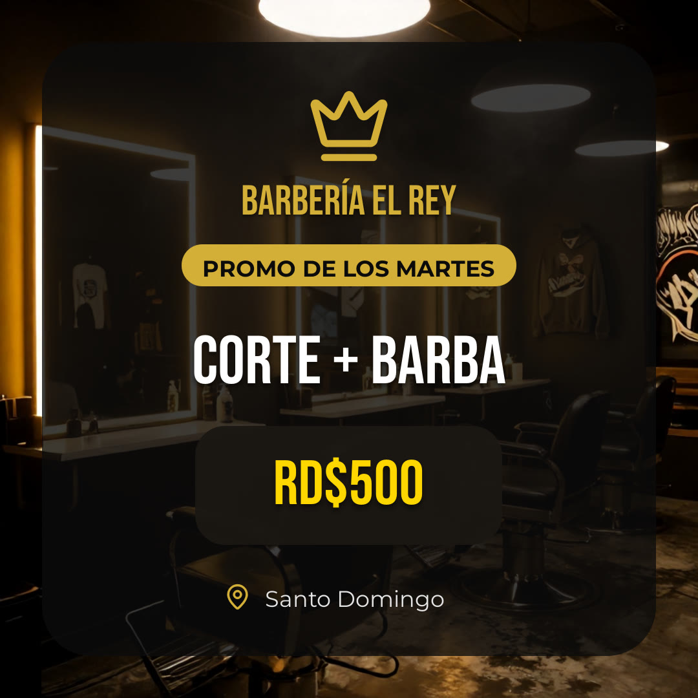 | 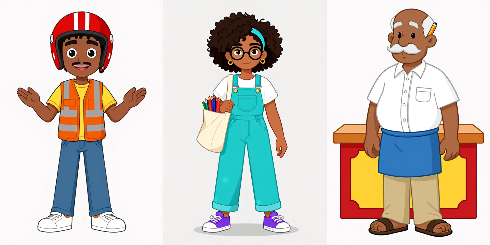 |
| Tuesday deal for “Barbería El Rey”, asked for in one sentence | Rafa, Yari and Don Tito: the reference sheets the studio uses for every shot |

These four are kept as they came out (two of the episode's six shots were left out: one had a typo in its script and
the other was left without its drawing when the free Pollinations balance ran out). The dance started as a still from
another video made in the studio and was brought to life by Wan 2.2 on your own Modal cloud (about US$0.30-0.60 of its
free monthly credit). Claude as Director wrote the cartoon's characters, Groq its script, Pollinations drew it and
Edge gave it voices, all free. Gemini laid out the post (a few cents) on a free Pollinations photo. Brands and people
are fictional.

## 🧰 What's inside

| Screen | What it does |
|---|---|
| 🤖 **AI Director** | Ask for the job in writing or with your voice (*"make an ad for my barbershop and a post"*); it plans and runs the right tools, step by step |
| ✨ **Create with AI** | Prompt → script → images → voice → animation → CapCut-style subtitles, vertical for TikTok/Reels/Shorts or horizontal for YouTube. Optional talking characters with lip sync |
| 🎨 **Design** | Illustrator-style workspace (tool column, zoom, align, properties and layers; 2,100+ icons, 14 fonts including gothic ones) and an AI that first understands your request (it asks when unsure, typos included), draws illustrations instead of stock photos and builds posts, thumbnails, flyers, logos and t-shirt prints **as editable layers**, without inventing prices or contacts. Photoshop-style blend modes and image adjustments, remove background, **Edit with AI** and 4K export |
| 🐰 **Cartoons** | Your cartoon series, episode by episode: original characters with a fixed look, a model sheet and their own voice; a storyboard of every shot, redo a single shot, and export frames to OpenToonz, Pencil2D or Krita |
| ✂️ **Video editor** | CapCut-style timeline: cuts, speed, transitions, effects synced to the beat, filters, text, stickers, auto subtitles; MP4 export up to 4K. **Record yourself** talking over the video with your webcam (or just your voice, or import a face video): one-click layouts (corner circle, full screen, split screen), the music lowers by itself while you speak, and the subtitles hear you. Camera and mic stay on your PC and only turn on when you ask |
| ⚡ **Magic Shorts** | Paste a long video link; the AI picks the best moments and crops them vertically with subtitles |
| 🚀 **Ads** | Product photo → several ad versions (A/B tests) that keep your real product |
| 🎵 **Music** | Lyrics and production in any genre (dembow, reggaetón, bachata…) plus a music video with karaoke lyrics |
| 🎙️ **Recording booth** | Record over the beat; tuning, genre vocal chains, sidechain mix and mastering |
| 🔎 **Viral niches** | Real YouTube views-per-day plus live web research (with Claude) → niches with ready ideas |
| 📅 **Publish** | Schedule your videos on YouTube with your own Google app: YouTube publishes them at the chosen time, even with your PC off |
| 🔌 **MCP** | Claude (or any agent) uses the whole studio from the chat |

**The AI Director, by voice.** Press **Talk** or **Ctrl+Space** and ask: the Director uses the whole studio for you,
like a studio with departments (script, design, music, cartoons, ads, editing, publishing) that each follow their own
quality rules. It works with any connected text AI (the free no-key one included) and stops after 6 steps so it
doesn't overspend. Before anything that costs money or publishes, it shows the cost and asks (answer "yes" or "no",
by voice too); it remembers your preferences per department, and you can see and delete them in "Studio memory".
Your voice is understood **on your PC** (Whisper) and it answers with the free Edge voices: nothing to pay.

**Characters that really talk.** Ask for "a talking apple" and the apple talks, with its own voice and lip sync
(Gemini Omni, or Kling or Seedance if you choose them; paid: ~US$1-2 per 8-second scene). The studio never spends
without asking: every job shows the maximum cost first, the Director asks before using it, and an MCP agent only gets
it done after you say "Yes" in a Ráfaga Studio window that the agent cannot read or answer.

## 🔑 All providers (bring your own keys)

**Free first** for images and video: they rotate through free daily quotas, your PC, credits and only then paid
services, so you can create every day without spending. For text and transcription you choose the provider. Kling and
Seedance connect with their own "Connect" button in "AI keys".

| Task | Free | With credits or paid |
|---|---|---|
| Text / scripts | Groq, Gemini, Pollinations (no key) | Claude, OpenAI, OpenRouter, xAI, DeepSeek |
| Images | Cloudflare Workers AI (~100/day), Pollinations, FLUX on Hugging Face (no key, a few a day) | OpenAI, Replicate, Gemini Nano Banana (only if you choose it: ~US$0.07 per image, keeps characters and products identical) |
| Image → video | Hugging Face ZeroGPU (Wan 2.2) | Your own Modal cloud (US$30 free/month with a card), Pollinations, Kling and Seedance (only if you choose them: ~US$0.02-0.24 per second, the maximum cost is shown before each job and there is a cap of 15 paid clips per job) |
| Talking video with lip sync | — | Gemini Omni (~US$0.10 per second), or Kling or Seedance if you choose them for “Talking scenes” (Create shows the cost first and the Director asks before using it) |
| Voice | Microsoft Edge voices | ElevenLabs |
| Transcription | Your PC (Whisper), Groq | OpenAI |
| Stem separation | Your PC (Demucs) | — |
| Music | — | ElevenLabs Music, Gemini Lyria |

## 🔌 Drive it from Claude (MCP)

Open **"🔌 MCP connection"** in the app and click connect: Ráfaga Studio registers itself in Claude Code and Claude
Desktop. Then just ask Claude: *"Make a 30-second vertical video about three places in the Dominican Republic"*. The
built-in [MCP](https://modelcontextprotocol.io) server exposes 17 tools, including `crear_video`, `sacar_shorts`,
`crear_anuncios`, `crear_cancion`, `crear_video_musical`, `crear_diseno`, `editar_video`, `crear_serie`,
`crear_episodio`, `investigar_nichos` and `programar_publicacion`: the same ones the Director uses inside the app.

## 🔒 Privacy and security

Ráfaga Studio installs and works on your PC: no servers of ours, no accounts, no analytics. Your keys are encrypted
with your Windows account (DPAPI). AI features send your requests directly to the service doing the work, including
free no-key services (Pollinations, a public Hugging Face Space, Microsoft's voices). Every data flow is listed, one by
one, in the [privacy notice](PRIVACIDAD.md). Found a security issue? See [SECURITY.md](SECURITY.md).

**🛡️ Ráfaga Guardia**, the guardian inside the app, logs on your PC what the app stops (network paths, links to your
local network, fake files, MCP agents that insist after your “No”, keys of another service…), checks that the app's
code is the one you installed, and locks paid video, images, music and voice, publishing, the memory and MCP until you
unlock it on its page. The rules decide; the AI only explains an event if you ask. It protects the app and what it
holds (your keys, money and data), not your whole PC: details and limits in
[SECURITY.md](SECURITY.md#ráfaga-guardia--el-vigilante-de-la-app).

## 🧑‍💻 For developers

[](requirements.lock)

**From source:**

```bat
git clone https://github.com/santo29/rafaga-studio.git
cd rafaga-studio
"Ráfaga Studio.bat"
```

Requires Python 3.14. [Node.js](https://nodejs.org) is recommended for YouTube downloads. To build the installer
yourself: `ISCC instalador\rafaga.iss` ([Inno Setup](https://jrsoftware.org/isinfo.php) 7).

**Use the engine as a Python library:**

```python
from motor import desde_prompt, shorts

desde_prompt.generar("A talking apple explains why fruit gives you energy", formato="9:16", segundos=16)
shorts.generar("https://youtu.be/…", formato="9:16", cantidad=3)
```

**How it works:**

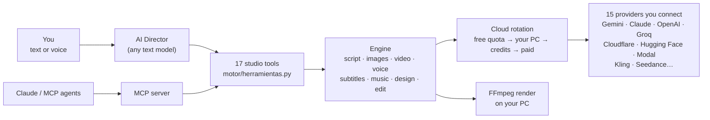

- **One tool registry** (`motor/herramientas.py`) feeds both the in-app Director and the MCP server, so the two never
  drift apart.
- **Untrusted input is checked at every boundary:** files must really be images, audio or video (by content, not by
  name), links must go to public hosts, keys only ever travel to their own provider, and agent-written scripts are
  validated before anything is spent.
- **Pinned and hashed dependencies** (`requirements.lock`): nothing different from what was tested gets installed,
  except yt-dlp and its yt-dlp-ejs component, which update themselves on launch (prebuilt wheels only, releases at
  least 7 days old, no new dependencies).
- **Offline test suite:** `python -m pruebas` runs the whole studio with fake AI services, no internet and no keys.

## 🗺️ Roadmap

- [x] Prompt-to-video, shorts, ads, music, design, video editor, cartoons (animated series)
- [x] AI Director with local voice control, MCP server
- [x] Talking characters with lip sync (Gemini Omni, Kling, Seedance)
- [x] Windows installer
- [ ] Free talking characters on your own GPU cloud (open speech-to-video models)
- [ ] macOS and Linux builds
- [ ] Plugin system for new providers and effects

## 🤝 Contributing

Ideas, bug reports and pull requests are welcome. Start with [CONTRIBUTING.md](CONTRIBUTING.md). Great first
contributions: new free providers in `motor/nubes.py`, vocal styles in `motor/cabina.py`, music genres in
`motor/musica.py`, and translations in `idiomas/`.

If Ráfaga Studio helps you, **give it a ⭐** and share it with a creator who doesn't code: it helps more people find it.

## 💜 Meet Rafa


Rafa is the studio's mascot, and it was made **with Ráfaga Studio's own designer**: Claude wrote the design as the Director and the studio drew it in 4K.

Ráfaga Studio was built by a Dominican creator with no big budget, just faith in God and a best friend: Claude. If it helps you create, a ⭐ helps it reach more creators.

<br clear="right">

## 📄 License

Ráfaga Studio is free software under the [GNU GPL-3.0](LICENSE): use it, study it, change it and share it, also
commercially, as long as whoever receives your version also receives its source code under the same license. It comes
with no warranty.

| Part | License |
|---|---|
| All the code: desktop app, engine, translations, tests, installer and examples | **GPL-3.0** |
| Icons (`assets/iconos`, Lucide) and fonts (`assets/fuentes`, Google Fonts) | ISC and OFL |
| Logo, cover and mascot (`assets/icono.*`, `assets/portada-github.png`, `assets/mascota.jpg`) | Ráfaga Studio™ trademark, all rights reserved |

See [LICENSE](LICENSE), [Terms](TERMINOS.md) and [Third-party notices](AVISOS_DE_TERCEROS.md).
**Ráfaga Studio™**, its name, logo and visual identity are trademarks of **Santo Montilla**: if you share a modified
version, give it another name and logo. © 2026 Santo Montilla.

Use your own content or content you have permission for, and label realistic AI-generated content: YouTube, TikTok
and Meta require it.
