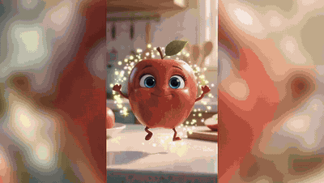
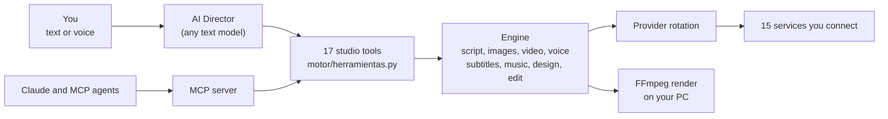

<div align="center">


# Ráfaga Studio

Ráfaga Studio exists to help content creators make their videos easily, without heavy editing and without paying for many tools at once.

The AI creative studio for Windows. Describe your idea, connect your own API key, and get a finished video.<br>
Or connect your favorite AI through MCP and direct the whole studio from your chat.

[](https://github.com/santo29/rafaga-studio/releases/latest)
[](LICENSE)
[](#install)
[](#connect-your-favorite-ai-mcp)
[](idiomas)

[Download for Windows](https://github.com/santo29/rafaga-studio/releases/latest) ·
[Free setup](#free-setup-3-videos-a-day) ·
[Watch the demo](ejemplos/presentacion-app-en.mp4) ·
[Leer en español](README.es.md)

https://github.com/user-attachments/assets/74f21c8e-2f5e-4906-b59d-5cff7e5332c9

<sub>This video was made with Ráfaga Studio itself: the real app on screen and the studio's own editor.</sub>

</div>

## Overview

Ráfaga Studio turns one sentence into a finished piece of content: script, scenes, voice, subtitles and the final cut.
It runs on your PC, with no coding, no terminal, no account and no subscription.

- **Your favorite AI, directing the studio.** Connect it through MCP, ask from your chat, and let it write the scripts.
- **One key box for every service.** Paste a key and the app recognizes which service it belongs to.
- **Real motion.** Text to video and photo to video, on your own Modal cloud or on the AI video service you choose.
- **An AI Director.** Ask by text or voice, attach your photos, and it plans the work and runs the right tools.
- **No membership and no surprise costs.** Free options are always available, and paid images, video, voices and songs
  show their maximum cost and ask first. Three things run without asking: the text AI you connected (cents per script,
  shown in **AI activity**), your own Modal credit and OpenAI if it is your transcription service, at US$0.006 per minute
  in the auto subtitles, Magic Shorts, music video and talking-scene pages. See [what a video costs](#what-a-video-costs).
- **Your data stays yours.** No servers of ours, no analytics. Keys are stored encrypted on your PC.

## Features

| Tool | What it does |
|---|---|
| AI Director | Plans and runs complete jobs from a text or voice request, in a full-page chat that shows your attachments and results. It knows which services you connected and how you set them up |
| Create with AI | Prompt to finished video, vertical or horizontal, with AI motion, voice-over, subtitles and a studio finish |
| Photo to video | Bring a photo to life with a camera move of your choice |
| Video editor | Timeline editing, transitions, beat-synced effects, text, stickers, auto subtitles, voice-over that places itself scene by scene, 4K export, webcam recording and AI avatar (beta) |
| Design | Layered posts, thumbnails, flyers, logos and t-shirt prints, with AI layouts and 4K export |
| Magic Shorts | Finds the best moments of a long video and crops them vertically with subtitles |
| Ads | Turns a product photo into several ad versions for A/B testing |
| Music | Lyrics, production and karaoke music videos in any genre |
| Recording booth | Records over a beat, with tuning, vocal chains, mixing and mastering |
| Cartoons | Animated series with consistent characters, storyboards and voices |
| Viral niches | Researches real YouTube data and suggests niches with ready-to-use ideas |
| Publish | Schedules videos on YouTube with your own Google app |

## Connect your favorite AI (MCP)

Turn the AI you already use into a complete creative studio. Connect it once, then ask for what you want from your chat:

> Make a 30-second vertical video about three places in the Dominican Republic.

Your AI directs. Ráfaga Studio produces the images, motion, voice, subtitles and final cut, and delivers the finished
file.

- **Save on text.** Your AI can write the scripts and designs itself, so the studio makes no text AI calls of its own for
  that work. Most of a video's cost is images and motion, which use the services set in **AI keys**, where free options
  are always available.
- **Create more than video.** 17 tools cover shorts, ads, songs, music videos, design, editing, animated series, niche
  research and YouTube scheduling.
- **Stay in control.** Paid images, video, voices and songs, publishing and saving to memory wait for your approval in
  a Ráfaga Studio window.

To connect, open **MCP connection** in the app and select connect. Ráfaga Studio registers itself in Claude Code and
Claude Desktop. Other [MCP](https://modelcontextprotocol.io) clients can launch `mcp_server.py` with the app's Python.

## Install

Requirements: 64-bit Windows 10 or 11, about 3 GB of free space and an internet connection. No graphics card is needed.

1. Download the latest `RafagaStudio-Setup` installer (about 53 MB) from
   [Releases](https://github.com/santo29/rafaga-studio/releases/latest), under Assets.
2. Open it. The installer is not code-signed yet, so Windows may show "Windows protected your PC". Select
   **More info**, then **Run anyway**. It does not ask for administrator rights.
3. Accept the terms and select **Install**. The installer downloads Python and the AI libraries (about 1.5 GB, 10 to 30
   minutes) and verifies the hash of every file. If your connection drops, run it again and it continues where it
   stopped.

## Quick start

1. Open **Create with AI** and type your idea, for example: *5 shocking facts about the deep ocean, mysterious tone*.
2. Select **Generate video**. A progress bar shows each scene as it is made.
3. When it finishes, watch it in the player, open its folder, or send it to the video editor.

This works with no key at all, using free services that can be slower and produce simpler results. Connecting Groq and
Cloudflare takes about two minutes, costs nothing and gives a much better first video. See the
[free setup](#free-setup-3-videos-a-day).

## Free setup: 3 videos a day

You don't need a paid plan to start. Create these free keys, paste each one into **AI keys**, and you can make about three
short videos a day at no cost.

| Service | What it does | Free allowance | Get it |
|---|---|---|---|
| Groq | Writes the scripts | Free plan | [Create a key](https://console.groq.com/keys) |
| Cloudflare Workers AI | Draws the images | About 100 images a day | [Create a token](https://dash.cloudflare.com/profile/api-tokens) |
| Modal (optional) | Adds real motion with Wan 2.2 | US$30 of compute a month | [Create a token](https://modal.com/settings/tokens) |

Voices (Microsoft Edge) and subtitles (Whisper, on your PC) are included and need no key.

What fits in these allowances:

- **Three 45-second videos a day** use up to 30 images, well within Cloudflare's daily allowance.
- **Modal's credit** covers at least 85 moving scenes a month, the app's default limit, which you can change in **AI
  keys**: roughly 3 a day, or about 8 fully animated 45-second videos. Any other scene uses a gentle zoom.
- **Without Modal**, a free public Hugging Face Space animates a few scenes a day, with a waiting line. It needs no key.

Modal's US$30 credit requires a card on file, so [set a US$30 usage limit](https://modal.com/settings/usage) and you pay
nothing. Each service sets its own limits, and they can change. The free Edge voices are not guaranteed for commercial
use. Free models can also make mistakes: see [free and low-cost models](#free-and-low-cost-models).

## Free and low-cost models

Free models are a good way to start, but they can make mistakes or drift from your request: a scene may miss a detail,
show something you did not ask for, or not match the narration. This can happen even when Claude or another AI directs
the studio through MCP. Your AI writes the script and the requests, but the images and video are still made by the
services you connected.

For videos you plan to publish, we recommend a low-cost model for images, such as Nano Banana on Gemini.

This is the same request sent to two models during a real test of Ráfaga Studio:

| Request | Free: FLUX.1 schnell on Cloudflare | Low-cost: Nano Banana on Gemini, about US$0.03 per image |
|---|---|---|
| Spiky burdock burrs on wool and dog fur |  |  |
| A white sneaker with a fabric strap and no shoelaces |  |  |

Results vary with each model and request, and no model gets everything right. To get the best results:

- Describe each scene in detail, including what must not appear.
- Choose your image and video services in **AI keys**.
- Review every scene before you publish.

## What a video costs

There is no membership. You pay each service directly for what you use, free options are always available, and the app
shows the maximum cost of paid images, video, voices and songs before they start.

This is what a 30-second vertical video with six moving scenes cost in a real test in November 2026:

| Step | Service | Cost |
|---|---|---|
| Script | Claude Opus 5.5 (Groq is free) | US$0.06 |
| 6 images | Nano Banana on Gemini (Cloudflare is free) | US$0.20 |
| 6 moving clips | Wan 2.2 on your Modal cloud | About US$0.91, from Modal's monthly credit |
| Voice, subtitles and editing | Microsoft Edge voices and your PC | Free |
| **Total** | | **About US$1.17** |

At those prices, and using Modal's US$30 monthly credit, a month would cost about US$3 for 10 videos, US$8 for 30 and
US$75 for 90. Without that credit, it would be about US$12, US$35 and US$105.

These figures come from one test and change with each video's length, the models you choose and each service's prices.
That video took about 11 minutes to make. Premium video models can give better results at a higher price, and you can
connect Kling or Seedance in **AI keys**. If you make many videos with one premium model, that service's own plan may
suit you better.

## Connect your AI services

Open **AI keys**, select **Get key** next to a service, create the key on its website, and paste it into the box at the
top. Keys are encrypted with your Windows account, and each one only ever travels to its own service.

| Service | What it adds | Price |
|---|---|---|
| Groq | Fast scripts and transcription | Free |
| Cloudflare Workers AI | About 100 images a day. Paste the account ID and the token together | Free |
| Pollinations | Images and scripts | Free |
| Gemini | Scripts, plus Nano Banana images, talking video and Lyria music if you choose them | Free, with paid options |
| Modal | Your own AI video cloud (Wan 2.2). Paste both parts of the token and select **Install engine on Modal** | US$1 free a month, or US$30 with a card on file (set a US$30 limit on Modal and you pay nothing) |
| ElevenLabs | Realistic voices and music | Small free plan |
| Kling, Seedance | Animated and talking scenes | Paid, only if you choose them |

Real motion is controlled by **Animate scenes with video AI**, in **AI keys**: leave it on Automatic or choose your Modal
cloud. **Check connections** shows the real status of every service and what to do if something is wrong.

<details>
<summary>All providers</summary>

| Task | Free | With credits or paid |
|---|---|---|
| Text and scripts | Groq, Gemini, Pollinations (no key) | Claude, OpenAI, OpenRouter, xAI, DeepSeek |
| Images | Cloudflare Workers AI, Pollinations, FLUX on Hugging Face (no key) | OpenAI, Replicate, Gemini Nano Banana |
| Image to video | Hugging Face ZeroGPU (Wan 2.2) | Your Modal cloud, Pollinations, Gemini Omni, Kling, Seedance |
| Talking video with lip sync | | Gemini Omni, Kling, Seedance |
| Voice | Microsoft Edge voices | ElevenLabs |
| Transcription | Your PC (Whisper), Groq | OpenAI |
| Stem separation | Your PC (Demucs) | |
| Music | | ElevenLabs Music, Gemini Lyria |

In Automatic mode the app uses your Modal cloud first when it is connected, and then free options. Kling and Seedance
are never used in Automatic mode, and paid clips are capped at 15 per job.

</details>

## Examples

Everything below was made with Ráfaga Studio. Brands and people are fictional.

| Talking character | Anime trailer | AI motion |
|---|---|---|
| <a href="ejemplos/manzana-habla.mp4"></a> | <a href="ejemplos/leyenda-rafaga.mp4"></a> | <a href="ejemplos/baile-merengue.mp4"></a> |

| Album cover | Event flyer | Logo |
|---|---|---|
|  |  |  |

| Brand ad | YouTube thumbnail | Mascot |
|---|---|---|
| <a href="ejemplos/anuncio-rafaga-en.mp4"></a> |  |  |

The requests and layered designs behind these examples are in [`ejemplos/`](ejemplos), so they can be reproduced with
`python ejemplos/crear.py` and `python ejemplos/crear_disenos.py`.

## Privacy and security

Ráfaga Studio has no servers of ours, no accounts and no analytics. AI features send your requests directly to the
service doing the work, including free no-key services. Every data flow is listed in the
[privacy notice](PRIVACIDAD.md).

Ráfaga Guardia, built into the app, logs what the app blocks, checks that its code is the one you installed, and can
lock anything sensitive until you unlock it. Read [SECURITY.md](SECURITY.md) for details and limits, and to report a
vulnerability.

## FAQ

<details>
<summary>Is it free?</summary>

Yes. The app has no accounts, subscriptions or in-app payments. You only pay the AI services you choose to use, directly
to them, and the app shows the maximum cost of paid images, video, voices and songs first. Commercial use of what you create is allowed; see the
[terms](TERMINOS.md). The free Microsoft Edge voices are not guaranteed for commercial use, so use a commercially
licensed voice for that.

</details>

<details>
<summary>Do I need a powerful PC?</summary>

No. Images and animation are made by online services or on your Modal cloud. Your PC assembles the video and runs
transcription and stem separation on the processor.

</details>

<details>
<summary>What happens if a service fails or runs out of balance?</summary>

The app warns you and moves to the next available option, without paying twice. If a step can only be done by paying,
it stops before charging and tells you how to fix it. **AI activity**, in **AI keys**, lists every call and an estimate
of what was spent.

</details>

<details>
<summary>Where are my videos?</summary>

In **My projects**. Select a project and then **Open folder**. Uninstalling the app does not delete your projects or
your keys.

</details>

<details>
<summary>Does it run on macOS or Linux?</summary>

Not yet. It is on the roadmap.

</details>

## Development

Requires Python 3.14. [Node.js](https://nodejs.org) is recommended for YouTube downloads.

```bat
git clone https://github.com/santo29/rafaga-studio.git
cd rafaga-studio
"Ráfaga Studio.bat"
```

Use the engine as a Python library:

```python
from motor import desde_prompt, shorts

desde_prompt.generar("A talking apple explains why fruit gives you energy", formato="9:16", segundos=16)
shorts.generar("https://youtu.be/…", formato="9:16", cantidad=3)
```



- One tool registry feeds both the Director and the MCP server, so they never drift apart.
- Untrusted input is checked at every boundary: file contents, links, API keys and agent-written scripts.
- Dependencies are pinned and hashed in `requirements.lock`.
- `python -m pruebas` runs the whole studio offline, with fake AI services and no keys.
- `ISCC instalador\rafaga.iss` builds the installer with [Inno Setup](https://jrsoftware.org/isinfo.php) 7.

## Roadmap

- [x] Prompt to video, shorts, ads, music, design, video editor and cartoons
- [x] AI Director with local voice control and MCP server
- [x] Talking characters with lip sync
- [x] Windows installer
- [ ] Stable AI avatars on your own GPU cloud
- [ ] macOS and Linux builds
- [ ] Plugin system for new providers and effects

## Contributing

Ideas, bug reports and pull requests are welcome. Read [CONTRIBUTING.md](CONTRIBUTING.md) to get started. Good first
contributions include new free providers in `motor/nubes.py`, vocal styles in `motor/cabina.py`, music genres in
`motor/musica.py` and translations in `idiomas/`.

If Ráfaga Studio is useful to you, please star the repository. It helps other creators find it.

## Responsible use

Use your own content or content you have permission to use, do not imitate real people without their consent, and label
realistic AI-generated content as YouTube, TikTok and Meta require. See the [terms](TERMINOS.md).

## Acknowledgements

Built with FFmpeg, faster-whisper, yt-dlp, Pedalboard, Demucs, Matchering, librosa, Praat, Wan 2.2, FLUX, edge-tts,
Lucide and Google Fonts. Full list in the [third-party notices](AVISOS_DE_TERCEROS.md).

Created in the Dominican Republic by Santo Montilla, with faith in God and Claude as a development partner.

## License

Ráfaga Studio is free software under the [GNU General Public License v3.0](LICENSE). You can use, study, change and
share it, also commercially, as long as anyone who receives your version also receives its source code under the same
license. It comes with no warranty.

Icons (Lucide, ISC) and fonts (Google Fonts, OFL) keep their own licenses. The Ráfaga Studio™ name, logo, cover and
mascot are trademarks of Santo Montilla and are not covered by the GPL: if you share a modified version, give it another
name and logo.

© 2026 Santo Montilla
