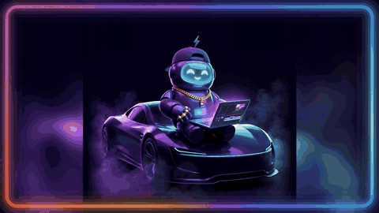
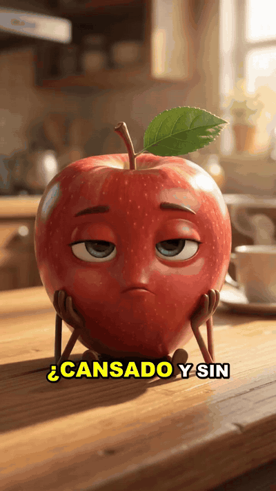
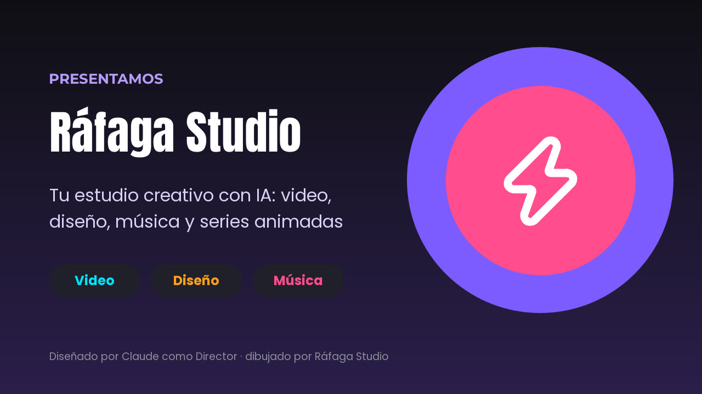
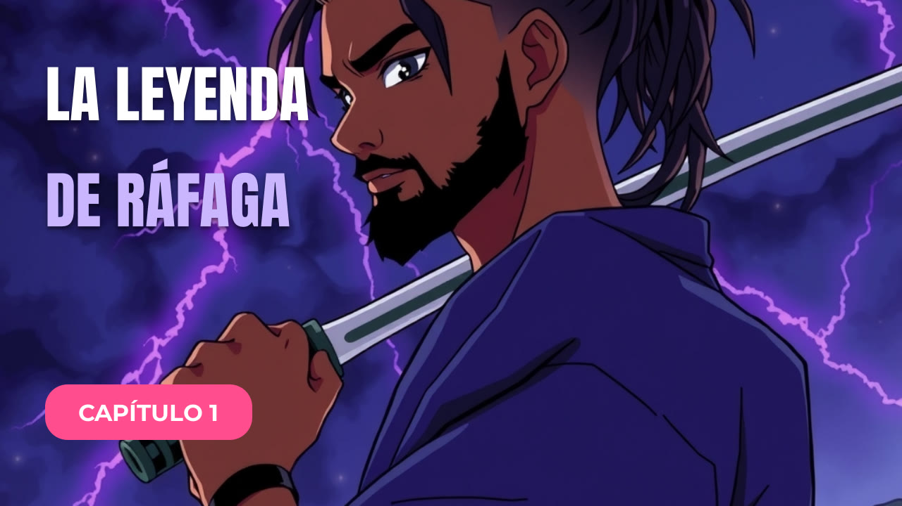
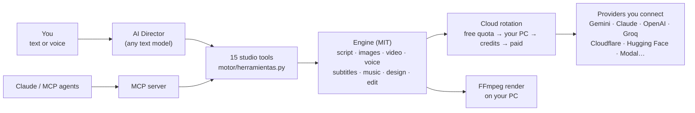

<div align="center">


# Ráfaga Studio

**The AI creative studio for your desktop.**<br>
Ask for a video in one sentence. Get the script, the scenes, the voice, the subtitles and the final cut.

[](LICENSE)
[](#-install)
[](requirements.lock)
[](#-drive-it-from-claude-mcp)
[](idiomas)

[**⬇ Download for Windows**](https://github.com/santo29/rafaga-studio/releases/latest) ·
[**▶ Watch the demo**](ejemplos/presentacion-app.mp4) ·
[**🇪🇸 Leer en español**](README.es.md)

<a href="ejemplos/presentacion-app.mp4"></a>

<sub>This demo was edited by Ráfaga Studio's own video editor. Claude wrote the script as the studio's Director.</sub>

</div>

---

## ✨ Why Ráfaga Studio

- **One prompt → a finished video.** Script, images, voice, animation, CapCut-style karaoke subtitles and editing, in
  one click. Vertical for TikTok/Reels/Shorts or horizontal for YouTube.
- **Characters that really talk.** Ask for "a talking apple" and the apple talks, with its own voice and lip sync
  (Gemini Omni, paid: ~US$1 per 8-second scene). The studio asks your API key which video models it has, picks the
  newest one with a known price, and never spends without asking: the Create screen shows the cost first and the
  Director asks before using it.
- **An AI Director you can talk to.** Push to talk, say *"make an ad for my barbershop and a post"*, and the Director
  uses the whole studio for you. Your voice is understood **on your PC** (Whisper); nothing to pay.
- **Drive it from Claude.** A built-in [MCP](https://modelcontextprotocol.io) server exposes 15 tools, so Claude Code,
  Claude Desktop or any MCP agent can produce videos, ads, songs, designs and series for you.
- **Free first, bring your own keys.** Paste any key and the studio detects the provider. Images and video rotate
  through free daily quotas, your PC, credits and only then paid services; for text and transcription you choose the
  provider.
- **Private by design.** No servers, no accounts, no analytics. Your projects and encrypted keys stay on your PC.

## 🎬 Made with Ráfaga Studio

| Talking character (9:16) | Viral short (9:16) | Product ad (9:16) | Anime trailer (16:9) |
|---|---|---|---|
|  |  |  |  |
| [watch](ejemplos/manzana-habla.mp4) · lip-synced voice | [watch](ejemplos/lugares-rd.mp4) · script, voice, subtitles | [watch](ejemplos/anuncio-cafe.mp4) · script, voice, closing card | [watch](ejemplos/leyenda-rafaga.mp4) · original characters |

| Real AI motion (Wan 2.2) | Presentation (16:9) | Brand post (4:5) | YouTube thumbnail |
|---|---|---|---|
|  |  |  |  |

Every example is reproducible: the requests, scripts and layered designs are in
[`ejemplos/ejemplos.json`](ejemplos/ejemplos.json) and [`ejemplos/disenos.json`](ejemplos/disenos.json).
`python ejemplos/crear.py` rebuilds the videos and `python ejemplos/crear_disenos.py` the designs. The talking apple
uses Gemini (paid, ~US$1 per scene) and the AI-motion anime uses your own Modal cloud.

## 🧰 What's inside

| Screen | What it does |
|---|---|
| 🤖 **AI Director** | Ask for the job in writing or with your voice; it plans and runs the right tools, step by step |
| ✨ **Create with AI** | Prompt → script → images → voice → animation → subtitles. Optional talking characters with lip sync |
| ⚡ **Magic Shorts** | Paste a long video link; the AI picks the best moments and crops them vertically with subtitles |
| 🚀 **Ads** | Product photo → several ad versions (A/B tests) that keep your real product |
| 🎵 **Music** | Lyrics and production in any genre (dembow, reggaetón, bachata…) plus a music video with karaoke lyrics |
| 🎨 **Design** | Canva-style layer editor (2,100+ icons, 8 fonts) and an AI that designs posts, thumbnails, flyers and logos **as editable layers** with your brand |
| ✂️ **Video editor** | CapCut-style timeline: cuts, speed, transitions, effects synced to the beat, filters, text, stickers, auto subtitles |
| 🎞️ **Animated series** | Your cartoon, episode by episode: original characters with a fixed look, a model sheet and their own voice |
| 🎙️ **Recording booth** | Record over the beat; tuning, genre vocal chains, sidechain mix and mastering |
| 🔎 **Viral niches** | Real YouTube views-per-day plus live web research (with Claude) → niches with ready ideas |
| 🔌 **MCP** | Claude (or any agent) uses the whole studio from the chat |

## 🏗️ How it works



- **One tool registry** (`motor/herramientas.py`) feeds both the in-app Director and the MCP server, so the two never
  drift apart.
- **Untrusted input is checked at every boundary:** files must really be images, audio or video (by content, not by
  name), links must go to public hosts, keys only ever travel to their own provider, and agent-written scripts are
  validated before anything is spent.
- **Pinned and hashed dependencies** (`requirements.lock`): nothing different from what was tested gets installed,
  except yt-dlp, which updates itself on launch (prebuilt wheels only, releases at least 7 days old).
- **Offline test suite:** `python pruebas.py` runs the whole studio with fake AI services, no internet and no keys.

## 📦 Install

**Windows installer (recommended):** download the `RafagaStudio-Setup` .exe from
[Releases](https://github.com/santo29/rafaga-studio/releases/latest) and run it. No admin rights needed. The installer
downloads the official portable Python and the AI libraries (about 1.5 GB), verifying the SHA-256 hash of every file.

**From source:**

```bat
git clone https://github.com/santo29/rafaga-studio.git
cd rafaga-studio
"Ráfaga Studio.bat"
```

Requires Python 3.14. [Node.js](https://nodejs.org) is recommended for YouTube downloads. To build the installer
yourself: `ISCC instalador\rafaga.iss` ([Inno Setup](https://jrsoftware.org/isinfo.php) 7).

## 🔑 Bring your own keys

| Task | Free | With credits or paid |
|---|---|---|
| Text / scripts | Groq, Gemini, Pollinations (no key) | Claude, OpenAI, OpenRouter, xAI, DeepSeek |
| Images | Cloudflare Workers AI (~100/day), Pollinations, FLUX on Hugging Face | OpenAI, Replicate |
| Image → video | Hugging Face ZeroGPU (Wan 2.2) | Your own Modal cloud ($30 free/month), Pollinations |
| Talking video with lip sync | — | Gemini Omni (~US$0.10 per second; Create shows the cost first and the Director asks before using it) |
| Voice | Microsoft Edge voices | ElevenLabs |
| Transcription | Your PC (Whisper), Groq | OpenAI |
| Stem separation | Your PC (Demucs) | — |
| Music | — | ElevenLabs Music, Gemini Lyria |

## 🔌 Drive it from Claude (MCP)

Open **MCP connection** in the app and click connect: Ráfaga Studio registers itself in Claude Code and Claude
Desktop. Then just ask Claude: *"Make a 30-second vertical video about three places in the Dominican Republic"*.
Tools include `crear_video`, `sacar_shorts`, `crear_anuncios`, `crear_cancion`, `crear_video_musical`,
`crear_diseno`, `editar_video`, `crear_serie`, `crear_episodio` and `investigar_nichos`.

Or use the engine as a Python library:

```python
from motor import desde_prompt, shorts

desde_prompt.generar("A talking apple explains why fruit gives you energy", formato="9:16", segundos=16)
shorts.generar("https://youtu.be/…", formato="9:16", cantidad=3)
```

## 🔒 Privacy and security

Ráfaga Studio installs and works on your PC: no servers of ours, no accounts, no analytics. Your keys are encrypted
with your Windows account (DPAPI). AI features send your requests directly to the service doing the work, including
free no-key services. Every data flow is listed, one by one, in the [privacy notice](PRIVACIDAD.md). Found a security
issue? See [SECURITY.md](SECURITY.md).

## 🗺️ Roadmap

- [x] Prompt-to-video, shorts, ads, music, design, video editor, animated series
- [x] AI Director with local voice control, MCP server
- [x] Talking characters with lip sync (Gemini Omni)
- [x] Windows installer
- [ ] Free talking characters on your own GPU cloud (open speech-to-video models)
- [ ] macOS and Linux builds
- [ ] Plugin system for new providers and effects

## 🤝 Contributing

Ideas, bug reports and pull requests are welcome. Start with [CONTRIBUTING.md](CONTRIBUTING.md). Great first
contributions: new free providers in `motor/nubes.py`, vocal styles in `motor/cabina.py`, music genres in
`motor/musica.py`, and translations in `idiomas/`.

If Ráfaga Studio helps you, **give it a ⭐**: it helps other creators find it.

## 📄 License

Open core:

| Part | License |
|---|---|
| Engine: `motor/`, `idiomas/`, `mcp_server.py`, `modal_app.py`, `pruebas.py`, `pruebas_seguridad.py`, `ejemplos/` | **MIT** |
| Desktop app: `app.py` and `ui/` (Ráfaga Studio Pro) | Source-available, all rights reserved |
| Other tests (`pruebas_*.py`), `prueba_real.py`, `actualizar_lock.py`, `instalador/` | Part of the app, all rights reserved |
| Icons (`assets/iconos`, Lucide) and fonts (`assets/fuentes`, Google Fonts) | ISC and OFL |
| Logo and cover (`assets/icono.*`, `assets/portada-github.png`) | Ráfaga Studio™ trademark, all rights reserved |

See [LICENSE](LICENSE), [Terms](TERMINOS.md) and [Third-party notices](AVISOS_DE_TERCEROS.md).
**Ráfaga Studio™**, its name, logo and visual identity are trademarks of **Santo Montilla**. © 2026 Santo Montilla.

Use your own content or content you have permission for, and label realistic AI-generated content: YouTube, TikTok
and Meta require it.
